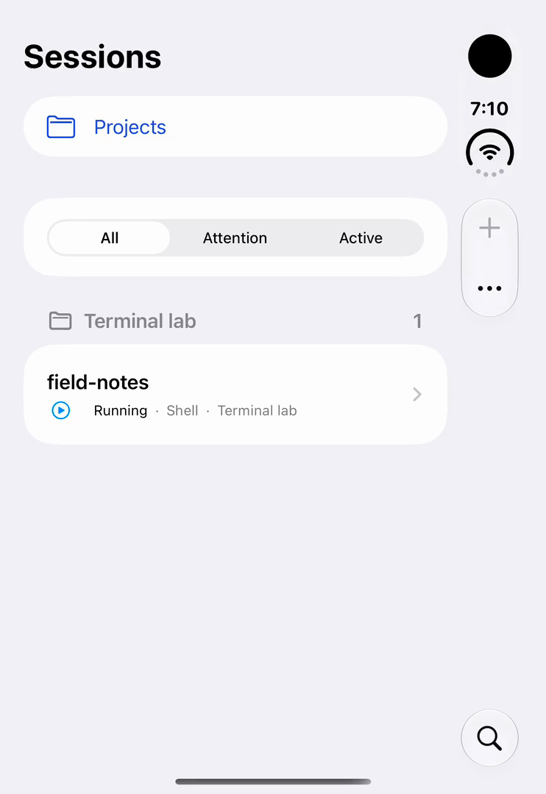
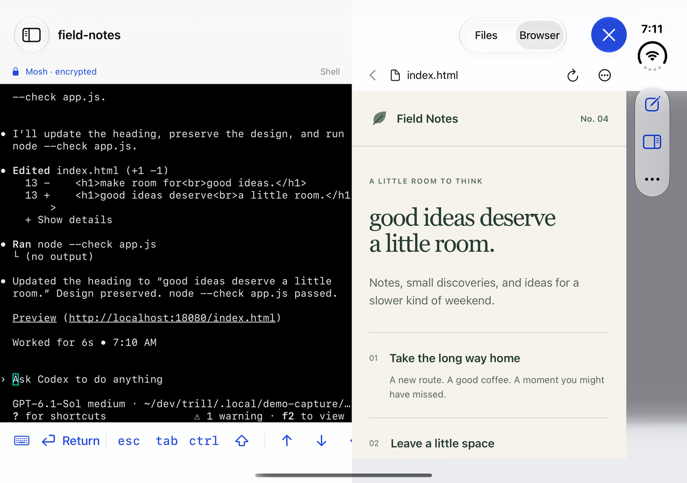

# Trill

Trill lets you control [Herdr](https://herdr.dev/) from your iPhone. Check on a coding session, send a prompt, browse its files, or preview a local web app beside the terminal. Your sessions keep running on your Mac when you disconnect.

The native iPhone app connects to a small Go companion on your Mac. It uses a real terminal: Herdr’s structured terminal stream over authenticated HTTPS. Install the Mac companion with **Homebrew** using the steps below. [Watch the demo](https://trill.bcook.io/).

<p>
  <picture>
    <source media="(prefers-color-scheme: dark)" srcset="website/assets/demos/duo-dark-cover.webp">
    
  </picture>
  <picture>
    <source media="(prefers-color-scheme: dark)" srcset="website/assets/demos/duo-dark-preview.webp">
    
  </picture>
</p>

Simulator captures showing the Duo cover and expanded layouts. [How the demos are recorded](docs/DEMOS.md).

## Quickstart

Before you start:

| Where | What you need |
| --- | --- |
| Mac running your sessions | Homebrew and a running Herdr installation. Go is not required. |
| Mac building the app | Xcode 27.1+ with the iOS 27.1 SDK. |
| iPhone | iOS 18.0 or later. |
| Connection | Both devices on a reachable LAN, or Tailscale configured on both. |

The Xcode version needed to build Trill is separate from the minimum iPhone OS. [Install prerequisites](docs/SETUP.md#prerequisites-and-supported-versions).

1. Clone this repository:

   ```sh
   git clone https://github.com/BCook98/trill.git
   cd trill
   ```

2. Open `ios/Trill.xcodeproj` in Xcode, choose the **Trill** scheme and your iPhone or simulator, and Run. For a device, select your signing team. [App installation details](docs/SETUP.md#install-the-iphone-app) cover SDK selection and the package-plugin prompt.

3. On the Mac that runs your sessions, install the companion:

   ```sh
   brew install --cask bcook98/tap/trill
   trill setup
   ```

   Herdr is the only provider. Setup prefers an already connected Tailscale client, otherwise your LAN. [Network prerequisites](docs/SETUP.md#choose-a-network) explain both options.

4. Type `pair` at the Mac's approval prompt. In Trill, choose **Pair a computer → Scan pairing code**, review the computer, and tap **Pair**. A simulator can [paste a pairing link](docs/SETUP.md#pair-your-iphone) instead.

5. Setup starts read-only. To open terminals and manage sessions, enable control:

   ```sh
   trill control --enable
   ```

   Changing control restarts the owned companion and disconnects its transports; the underlying sessions keep running. Select a session in Trill and approve terminal access on the phone. It opens directly.

## What you can do

- Switch between saved computers and browse sessions by project, activity, or attention.
- Create Herdr spaces, Git worktrees, and terminal tabs; start coding agents inside those terminals.
- Type directly, write and dictate a draft, or upload a photo and insert its file path.
- Capture follow-ups in a Space’s Ideas queue, reorder them, and bring one into a terminal draft when ready.
- Read project files, view images and videos, preview static HTML, and open a Mac-local development server beside the terminal.

[Usage guide](docs/USAGE.md) · [Setup, updates, removal, and troubleshooting](docs/SETUP.md) · [Provider capabilities](docs/PROVIDERS.md)

Keep your Mac awake and reachable. Trill connects directly over HTTPS, with one saved computer active at a time. It has no push service. If iOS closes the app, reopen your terminal when you return. See [connection recovery and current limits](docs/USAGE.md#backgrounding-and-recovery), including physical-device roaming checks still needed before release.

## Find your next step

| I want to… | Guide |
| --- | --- |
| Install, pair, update, or fix a connection | [Setup and troubleshooting](docs/SETUP.md) |
| Use sessions, terminals, files, previews, or photos | [Usage](docs/USAGE.md) |
| Try a safe sandbox without installing a provider | [Scripted demo server](docs/DEMO_RUNTIME.md) |
| Build, test, or contribute | [Development](docs/DEVELOPMENT.md) and [contributing](CONTRIBUTING.md) |
| Understand the companion or integrate with it | [Architecture](docs/ARCHITECTURE.md), [CLI reference](sidecar/README.md), and [API](docs/API.md) |
| Prepare a TestFlight build | [Release process](docs/RELEASING.md) |
| Prepare signed Mac companion downloads or diagnose/update an installation | [Companion distribution and maintenance](docs/COMPANION_RELEASES.md) |
| Understand access or report a vulnerability | [Security](SECURITY.md) |


Independent companion for Herdr. Trill's original code, documentation, and artwork are [MIT-licensed](LICENSE). Third-party material retains its owners' rights; see [scope and notices](docs/THIRD_PARTY.md).
