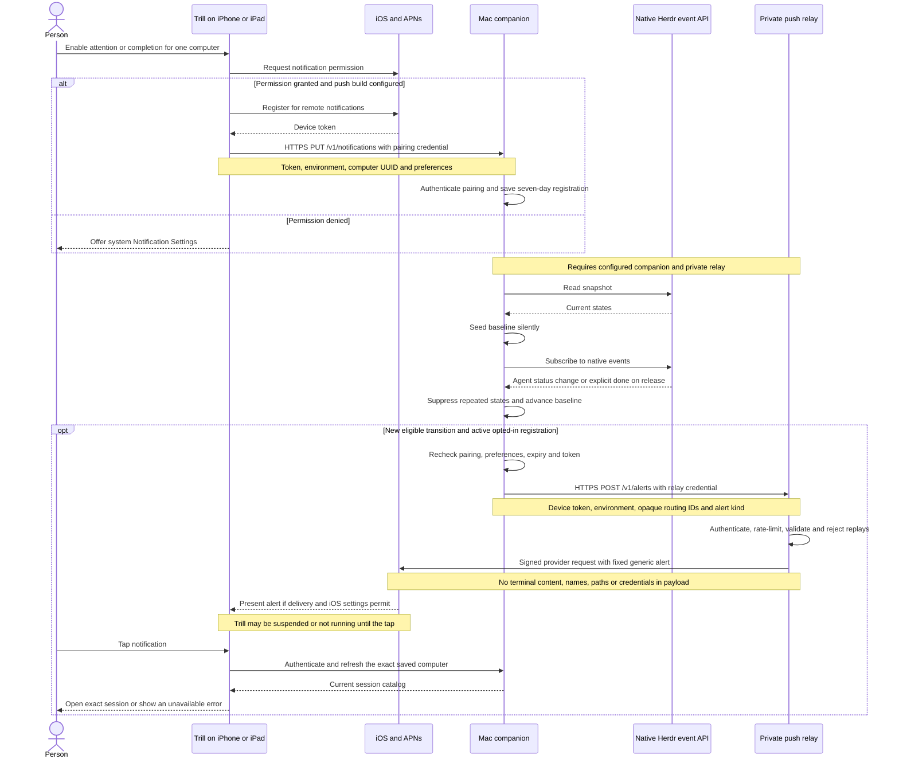
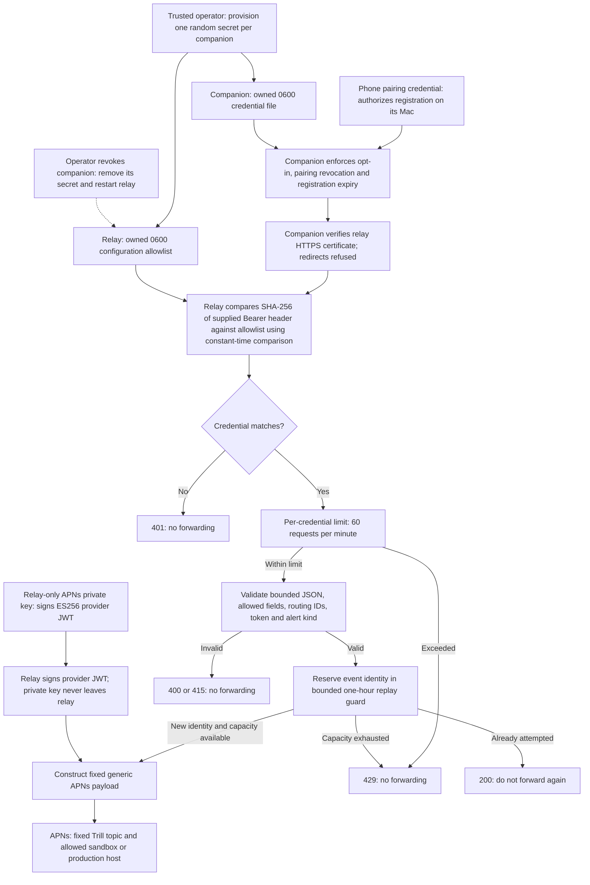

# Herdr agent notifications (draft integration)

This feature is **off by default and not operational in distributed builds**. This PR supplies the iOS client, companion event watcher, and an operator-managed APNs relay. No relay has been deployed, no Apple account capability/profile has been changed, and no real APNs delivery has been validated. Keep the PR draft until the prerequisites below are reviewed and completed separately.

## Behavior

Connection details → Agent Notifications contains native per-computer toggles for **Needs attention** and **Finished work**, both initially off. Turning on a toggle requests iOS notification authorization in context. Denial provides a link to the system notification settings. The screen distinguishes an unconfigured build/companion from registration and explains the Mac connectivity and renewal requirements. Preferences are stored with the pairing in device-only Keychain storage. A registration is scoped to the authenticated device on that computer; legacy master-token authentication cannot register.

The companion opens Herdr's native Unix event API even when the phone is suspended. It uses `pane.agent_status_changed`, with the protocol-22 event envelope `event: pane_agent_status_changed`, `data.type: pane_agent_status_changed`, `data.pane_id`, and `data.agent_status`. These were inspected with the installed Herdr binary's **schema command only**, without attaching to personal sessions. Its enum is `idle`, `working`, `blocked`, `done`, `unknown`. Trill's display mapping changes `blocked` to `waiting_for_input` and `done` to `idle`, so notification decisions preserve the native status separately.

- A known state entering `blocked` produces attention; `working` or `blocked` entering `done` produces completion. A native agent-release event with explicit `final_status: done` also completes observed working/blocked work. Unknown states, idle shells, ordinary agent discovery, and process exit do not imply completion.
- A snapshot seeds the initial/reconnected subscription silently. Repeated statuses do not alert. Pane topology and agent identity changes rebuild the subscription with a silent baseline. Terminal IDs are hashed with the Herdr server namespace, preserving exact identity across pane moves and separating servers.
- The same APNs alert path serves foreground and background. There is no iOS polling notification loop, local notification fallback, silent background push claim, or extra background execution entitlement.
- Tapping an alert selects the saved computer, refreshes it, selects the exact session, and brings the native detail navigation forward. A missing computer, offline computer, or removed session produces an explicit error; it never picks another similarly named session. Existing terminal-consent checks still apply.
- Disable deletes the registration. Forget/re-pair waits for deletion before discarding credentials; if offline, it explains that cleanup needs reconnection or device revocation on the Mac. Revocation atomically removes the registration from the pairing store. APNs `Unregistered`, `BadDeviceToken`, and `DeviceTokenNotForTopic` retire the matching token without erasing a newer rotated token.
- iOS permission changes are reconciled for all opted-in computers when Trill becomes active. iOS does not notify an absent app of Settings revocation: the companion may continue attempting generic alerts until the next reconciliation, device revocation, APNs invalidation, or lease expiry. Registration expires after seven days without renewal; expired registrations are excluded immediately and physically removed on the next pairing-store write.

## Notification flow

This is the configured delivery path; the current build defaults remain disabled. Enrollment uses the phone's existing pairing credential. Alert delivery continues on the Mac without requiring Trill to run on the phone.



There is no automatic retry or outbox. A rejected APNs device token is reported through the relay so the companion can remove that matching registration. Disable, forget/re-pair, and device revocation clean up registrations as described above; an alert already handed to Apple cannot be recalled.

## How the relay trusts a companion

The relay trusts **possession of an operator-provisioned bearer credential**. The operator creates a different random 32-byte secret for each trusted companion and installs the same secret in that companion's private credential file and the relay's private allowlist. The phone pairing credential and the Apple signing key are separate credentials for separate boundaries.



This authenticates the credential holder, not the companion binary or Mac hardware: there is no mutual TLS, device attestation, or automatic enrollment. The relay does not independently verify that a supplied APNs token belongs to a phone paired with that companion, or that the claimed Herdr event occurred. It relies on the trusted companion to enforce those rules. Anyone holding a valid companion secret can submit otherwise valid alerts within these limits, which is why this implementation is restricted to a manually provisioned trusted pilot. Removing a relay credential blocks subsequent requests after restart; it cannot recall requests already forwarded to Apple.

## Delivery limits

The Mac must be awake, online, running both Herdr and the configured companion. The relay must be available and Apple must accept/deliver the alert. Focus, device settings, and network conditions affect presentation. There is deliberately **no replay/outbox and no automatic send retry**: state advances before a send, and ambiguous network failures may drop alerts rather than duplicate them. Subscription gaps, topology changes, companion/Herdr restarts and backpressure can miss transitions. APNs uses the event UUID for `apns-id` and `apns-collapse-id` and `apns-expiration: 0` to avoid stale delivery queues. This is best-effort alerting, not an audit log or exactly-once transport. An alert already handed to Apple cannot be recalled by revocation.

## Prerequisites before enabling

1. An operator must provision a private HTTPS relay host with a publicly trusted TLS certificate, secure secret storage, access controls, and a documented retention policy. This PR does not deploy it. Each trusted companion needs its own random 32-byte hex relay credential; removing that credential from the relay configuration and restarting the relay revokes its sending access. The relay is intended for a manually provisioned pilot, not anonymous public enrollment. It limits each credential to 60 requests/minute and keeps a bounded one-hour in-memory replay guard of hashed event identities. Restarting the relay clears that guard; companions still do not retry sends. An unattended public rollout requires an enrollment/abuse-management design and operational review first.
2. A maintainer with Apple account authority must separately enable Push Notifications for `io.bcook.trill`, issue/download compatible development/distribution provisioning profiles, and create an APNs P-256 token-signing key. Keep the `.p8`, team/key identifiers, and TLS private keys on the trusted relay host/secret manager. **Never distribute the Apple key to user companions or embed it in the app.** No keys or real credential examples are tracked here.
3. Configure an opt-in app build with `CODE_SIGN_ENTITLEMENTS=Trill/Push.entitlements`, `TRILL_APNS_ENVIRONMENT=development`, and `TRILL_PUSH_ENVIRONMENT=sandbox` for development device signing. For TestFlight/App Store signing, use `TRILL_APNS_ENVIRONMENT=production` and `TRILL_PUSH_ENVIRONMENT=production`. Verify the archived app's signed `aps-environment` agrees with the configured push environment. Default project settings retain `TRILL_PUSH_ENVIRONMENT=disabled` and no push entitlement. Simulator tests do not prove real APNs registration. No marketing version change is needed.
4. After independent approval, configure the companion process with the explicit relay flags below. The existing installer/LaunchAgent setup does not silently add them and will not preserve manually added flags across setup regeneration. A reviewed installation/configuration update is needed before broad distribution; do not restart an existing production companion as part of reviewing this PR.
5. Perform an isolated physical-device acceptance test: opt in; suspend/terminate Trill; drive a disposable Herdr agent through working→blocked and working→done; verify one generic alert per transition and exact cold-start routing across two computers. Check denial/revocation, token rotation, offline forget, restart/catalog silence, and sandbox/production separation. Record actual delivery evidence before marking the PR ready.

## Relay configuration

Build without running or deploying:

```sh
(cd sidecar && go build -o ../.build/trill-push-relay ./cmd/trill-push-relay)
```

Create a **0600**, owned, regular JSON file on the relay host (absolute paths; placeholders below are intentionally invalid):

```json
{
  "listen": "127.0.0.1:8443",
  "tlsCertificate": "/private/relay/fullchain.pem",
  "tlsKey": "/private/relay/tls-key.pem",
  "apnsKey": "/private/relay/AuthKey.p8",
  "keyId": "APPLE_KEY_ID",
  "teamId": "APPLE_TEAM_ID",
  "topic": "io.bcook.trill",
  "companionCredentials": ["REPLACE_WITH_A_DISTINCT_RANDOM_64_CHARACTER_HEX_SECRET"]
}
```

The APNs key file must also be owned, regular, and 0600. The relay command is `trill-push-relay --config /absolute/private/relay.json`. TLS terminates at this process; a reverse proxy must preserve HTTPS and must not log request bodies, authorization headers, or device tokens. The server accepts only `POST /v1/alerts`; unknown fields and arbitrary alert content are rejected. Sandbox/production hosts and the bundle topic are allowlisted in code. Provider JWTs are signed ES256 and refreshed after 50 minutes. Network/APNs failures return generic status codes without tokens or Apple response bodies.

On each opted-in companion, keep its relay credential in a private 0600 file and add:

```text
--push-relay-url https://YOUR-RELAY-HOST/v1/alerts
--push-relay-credential-file /absolute/private/companion-relay-credential
```

These flags require the existing pairing store. Registration endpoints use the companion's existing authenticated HTTPS transport and certificate policy. The relay client refuses HTTP, credentials in URLs, query parameters, and redirects. A missing or invalid configuration fails startup explicitly. Without flags, registration returns an explicit unavailable response and no watcher runs.

## Privacy boundary

The relay sees the APNs device token, sandbox/production selection, a phone-local computer UUID, a hashed session ID, a random event UUID, and `attention`/`completion`. APNs receives fixed title/body text and the three routing UUID/ID fields. No terminal output, prompt, filename, path, computer/session display name, pairing credential, or relay credential is permitted in the APNs payload. Device tokens live in the companion's existing private atomic pairing store and are omitted from HTTP status responses and device listings. The relay does not persist registrations or payloads and emits no request-content logs. Hosting/TLS infrastructure can still observe network metadata; the operator must document its handling before enabling a service. Publish the matching privacy policy before distribution.

## API and local checks

- `GET /v1/notifications`: authenticated availability and current preferences/expiry, never token.
- `PUT /v1/notifications`: paired-device-only validated `token`, `environment`, `computerId`, `attention`, `completion`; idempotently replaces/renews this pairing's registration.
- `DELETE /v1/notifications`: deletes this pairing's registration even if the relay is disabled.

Tests use generated crypto keys, fake HTTP transports, temporary pairing stores and a synthetic Herdr Unix socket. They do not contact APNs, start an agent, deploy a service, or touch personal terminals. Run `go test ./...`, `go vet ./...`, and `go test -race ./push ./pairing .` in `sidecar`, plus the `TrillTests` target on a newly created test simulator. Physical APNs validation remains a separate prerequisite.

Design references: [Apple notification HIG](https://developer.apple.com/design/human-interface-guidelines/notifications), [requesting permission](https://developer.apple.com/documentation/usernotifications/asking-permission-to-use-notifications), [APNs requests](https://developer.apple.com/documentation/usernotifications/sending-notification-requests-to-apns), [APNs responses](https://developer.apple.com/documentation/usernotifications/handling-notification-responses-from-apns).
