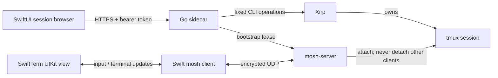

# Architecture

The control plane carries metadata, explicit session operations, and authenticated photo uploads. The terminal plane carries terminal protocol output and input. Trill never treats agent sessions as chats and never reconstructs their history.

The companion can aggregate independent Xirp and Herdr sources. Provider catalogs carry item-level capabilities and availability, while the existing transport owns all mosh leases. Herdr attaches through its installed direct-terminal client; it does not require a tmux wrapper. Stable terminal identities route native Herdr operations after a fresh metadata lookup. See [provider boundaries](PROVIDERS.md).

## Boundaries

- Xirp owns agents, worktrees, session metadata, start/stop/resume semantics and tmux targets.
- Go invokes a bounded set of CLI operations with separate argument vectors; no generic command execution API or arbitrary Xirp proxy.
- API bootstrap returns a short-lived connection key over authenticated HTTPS. The phone uses it directly with mosh-server; no SSH credential is needed on the phone.
- A lease owns exactly one spawned mosh-server. Disconnect cleans up that server, while the tmux session stays alive. Attach never uses `-d`.
- iOS stores a validated library of saved computers, bearer tokens, and the active choice in one atomic device-only Keychain item. Legacy primary pairing migrates only after that save succeeds. Switching closes Trill transports and clears host metadata; drafts and selection are scoped by stable computer UUID and session ID. Mosh keys and checkpoints stay in memory. Relaunch after process eviction requires a fresh attach.
- Server certificate verification uses system trust, or an exact SHA-256 leaf fingerprint entered out of band. Redirects are refused.
- The default sidecar is read-only: authenticated metadata is available, while terminal attachment, mutations, file/media reads, uploads, and browser-grant creation require global control on the computer. Control is shared by authorized devices, not scoped per project. See [Security](../SECURITY.md) for trust and revocation limits.

## Foreground connection recovery

On return to the foreground, Trill first tries the retained Mosh client and lease. An increase in accepted peer responses, including ACK-only traffic, is required before enabling input. Stalled resume falls back to a fresh authenticated attach to the authoritative provider target. A previously unseen delayed authenticated packet can count as a response; this is a liveness heuristic, not a fresh challenge/response guarantee. Transient failures retry at 1, 2, 4, 8, 15, then 30 seconds, only while foreground and connection intent remains active. Attempts are serialized per connection, generation-checked, and release late leases. Explicit disconnect clears intent; archive/stop and pairing changes also disconnect. Permanent HTTP failures stop recovery. Neither input nor drafts are replayed across fresh transports.

SwiftTerm's automatic terminal-protocol replies bypass the one-shot keyboard modifiers. This prevents a cursor-position query from consuming Shift before Shift+Return.

## Photo attachments

The system photo picker grants access to selected images. iOS downsampling applies orientation and re-encodes JPEG without source EXIF/location metadata. Uploads use authenticated HTTPS and require session control. The companion receives raw image bytes and chooses the storage path; clients cannot select a destination or filename. The storage root is `~/.local/share/trill/attachments`, scoped by session hash, with private atomic writes and limits of 10 MiB per image, 40 megapixels, 250 MiB total, and 4096 storage entries. Files are retained until removed by the owner. The phone adds a shell-quoted absolute path to the draft, and only the user's Insert action sends it to the real terminal. There is no agent-specific upload, simulated chat, or automatic Return.

## Testing safety

Tests never invoke stop/resume/create/rename or send terminal input on existing Xirp sessions. Real transport testing uses a private tmux socket and a shell created specifically for Trill. Unit tests use a fake command runner only to verify protocol behavior. Those fixtures are not part of the product experience.

## Current limits

Trill connects to one computer at a time. It has no push notification service, background execution entitlement, or persistent terminal snapshot after process eviction. Mosh supports foreground recovery; actual cross-network roaming, packet loss, suspension duration, and radio changes need physical-device release testing. Read-only periodic metadata polling is every ten seconds. Agent actions are provided by the installed Xirp and subject to its version and project configuration.

The terminal stays alive across SwiftUI layout changes. The system split-view handles compact/expanded navigation. The 27.1 SDK enables native side navigation. `TerminalViewportRegion` queries active division and occlusion regions locally and changes the terminal’s frame without replacing its connection or UIView. NavigationSplitView remains the navigation container; an ArrangementView is unnecessary for this single terminal viewport.

## Managed setup and device identity

`trill` owns network discovery, certificate provisioning, QR invitations, device revocation, and user LaunchAgents. Tailscale supplies a stable hostname and trusted certificate; local-network setup uses Bonjour plus a pinned leaf. The iOS app retains ATS, requires HTTPS outside the isolated simulator loopback mode, rejects redirects, and checks both the scanned fingerprint and SSL hostname/validity for pinned certificates. Certificate renewal replaces an atomic PEM bundle; the daemon loads valid replacements on subsequent TLS handshakes without restarting mosh leases.

Pairing state stores only credential hashes in a private, atomically replaced file protected by a cross-process lock. Short-lived invitations are consumed atomically. An HTTP-layer owner map ties mosh leases to device identities; revocation monitoring delegates cleanup to the existing lease lifecycle and never changes tmux session ownership.

## Files and browser

The native SwiftUI inspector presents Files and Browser alongside the terminal when space allows and adapts to a sheet in compact layouts. It does not replace the terminal connection. Source previews use selectable native text; supported images use native image rendering. File reads resolve the authoritative session worktree or project root on the Mac, use `os.Root` confinement (including symlinks), refuse special files and traversal, and cap text at 2 MiB, images at 10 MiB, and directory listings at 1000 items. iOS checks image dimensions against a 40-megapixel budget and generates a maximum 2048-pixel thumbnail off the main actor before rendering. Archived sessions can browse existing files without resuming. A separate Photos source reads only that session’s private attachment directory.

Browser uses WKWebView with a private, nonpersistent data store and no native message bridge. An explicit localhost address requests a short-lived preview grant for an unprivileged port on the Mac’s IPv4 loopback interface. The companion forwards page paths, assets, and supported WebSocket traffic over paired HTTPS. WebKit receives only the temporary HttpOnly/Secure preview cookie; it never receives the API bearer token. Switching ports resets the browser store. Explicit workspace teardown or navigating to an external top-level page releases the grant; hiding and reopening retained workspace state can preserve it. HTTP and WebSocket resource rules prevent the capability cookie reaching another port on the companion host. External pages use normal WebKit trust and ATS. Development servers must already be running; preview does not launch them. Grant creation checks session liveness but does not prove that the chosen loopback port belongs to that session. Live pages can execute JavaScript and modify the selected HTTP service.

Connection details are a troubleshooting destination in the Sessions overflow menu. Once paired, the main app focuses on Sessions and Projects without a persistent computer tab or computer identity card.

## Creation compatibility

Xirp 0.60’s CLI catalog rejects `requestId` for coding-session creation. Trill uses a supported random `trill-…` tag to find the exact newly created agent session and validates its project, goal, name, terminal state, and worktree/root path. The one correlation tag remains in Xirp metadata because no atomic remove-single-tag API exists. Standalone terminal creation supports `requestId` directly. Neither path retries the creation mutation; an uncertain outcome asks the user to inspect Sessions.

## Static document preview

HTML/HTM/SVG previews use a private WebKit URL scheme and ephemeral store. Native asset reads retain the paired API bearer token outside WebKit. The dedicated authenticated, control-gated static-file route confines reads to the selected containing folder, rejects symlinks and hidden path components, and allows only presentation asset extensions. Responses retain the existing file size bounds; native loading additionally caps concurrent requests, aggregate bytes, and total asset count. Closing a preview cancels pending reads without invoking stopped WebKit tasks.

Static mode disables content JavaScript through WebKit preferences, including script-created WebRTC, and applies restrictive CSP plus HTTP/WebSocket content rules. Dynamic applications continue to use the separate localhost-port preview grant. Session-row menus reset when the active computer changes.
