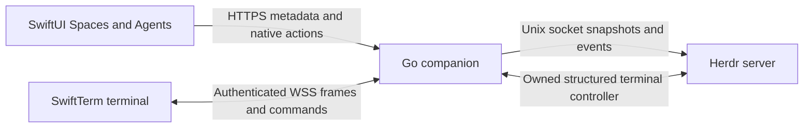

# Architecture

Herdr owns terminals, programs, workspaces, worktrees and agent detection. The companion resolves current authoritative IDs before native operations. Metadata uses bounded Unix-socket requests with CLI fallback; native events invalidate catalogs, with periodic refresh for missing events. Trill never reconstructs agent history from transcripts.

The terminal has one transport: an authenticated WebSocket over the companion’s HTTPS origin. Lease creation returns only an identifier. The controller relays bounded JSON frames and a strict input/resize/scroll/release allowlist. Disconnect, revocation, expiry and shutdown release the controller while the terminal survives. No SSH credential or separate port is needed.

Selecting a live session opens it after consent. Leaving its detail view or backgrounding releases controller ownership and desktop sizing. Returning attaches fresh after cleanup. Explicit Disconnect clears that intent. Foreground transient recovery is serialized and generation-checked; late leases are released and input is never replayed.

The companion is read-only until control is enabled on the Mac. Device credentials, TLS pins and saved computers are retained in the device-only Keychain. Switching computers drains connections and scopes drafts and selections to stable computer/session IDs. The phone uses system trust or an exact out-of-band certificate pin and refuses redirects.

SwiftTerm’s protocol replies bypass keyboard modifiers. Link taps resolve validated HTTP(S) destinations on the phone before remote mouse input; explicit scroll commands preserve the touched cell. Layout changes retain the terminal view and connection.

## Photo attachments

The system photo picker grants access to selected images. iOS downsampling applies orientation and re-encodes JPEG without source EXIF/location metadata. Uploads use authenticated HTTPS and require session control. The companion receives raw image bytes and chooses the storage path; clients cannot select a destination or filename. The storage root is `~/.local/share/trill/attachments`, scoped by session hash, with private atomic writes and limits of 10 MiB per image, 40 megapixels, 250 MiB total, and 4096 storage entries. Files are retained until removed by the owner. The phone adds a shell-quoted absolute path to the draft, and only the user's Insert action sends it to the real terminal. There is no agent-specific upload, simulated chat, or automatic Return.

## Testing safety and limits

Tests use synthetic runners, disposable demo directories and separately created Herdr servers. They never send input or mutations to personal sessions. Physical-device network roaming and sustained output require separate release checks. Trill has no push service or persistent screen snapshot after process eviction.

The terminal stays alive across SwiftUI layout changes. The system split-view handles compact/expanded navigation. The 27.1 SDK enables native side navigation. `TerminalViewportRegion` queries active division and occlusion regions locally and changes the terminal’s frame without replacing its connection or UIView. NavigationSplitView remains the navigation container; an ArrangementView is unnecessary for this single terminal viewport.

## Managed setup and device identity

`trill` owns network discovery, certificate provisioning, QR invitations, device revocation, and user LaunchAgents. Tailscale supplies a stable hostname and trusted certificate; local-network setup uses Bonjour plus a pinned leaf. The iOS app retains ATS, requires HTTPS outside the isolated simulator loopback mode, rejects redirects, and checks both the scanned fingerprint and SSL hostname/validity for pinned certificates. Certificate renewal replaces an atomic PEM bundle; the daemon loads valid replacements on subsequent TLS handshakes without restarting terminal leases.

Pairing state stores only credential hashes in a private, atomically replaced file protected by a cross-process lock. Short-lived invitations are consumed atomically. An HTTP-layer owner map ties terminal leases to device identities; revocation monitoring delegates cleanup to the existing lease lifecycle and never changes Herdr terminal ownership.

## Files and browser

The native SwiftUI inspector presents Files and Browser alongside the terminal when space allows and adapts to a sheet in compact layouts. It does not replace the terminal connection. Source previews use selectable native text; supported images use native image rendering. File reads resolve the authoritative session worktree or project root on the Mac, use `os.Root` confinement (including symlinks), refuse special files and traversal, and cap text at 2 MiB, images at 10 MiB, and directory listings at 1000 items. iOS checks image dimensions against a 40-megapixel budget and generates a maximum 2048-pixel thumbnail off the main actor before rendering. Archived sessions can browse existing files without resuming. A separate Photos source reads only that session’s private attachment directory.

Browser uses WKWebView with a private, nonpersistent data store and no native message bridge. An explicit localhost address requests a short-lived preview grant for an unprivileged port on the Mac’s IPv4 loopback interface. The companion forwards page paths, assets, and supported WebSocket traffic over paired HTTPS. WebKit receives only the temporary HttpOnly/Secure preview cookie; it never receives the API bearer token. Switching ports resets the browser store. Explicit workspace teardown or navigating to an external top-level page releases the grant; hiding and reopening retained workspace state can preserve it. HTTP and WebSocket resource rules prevent the capability cookie reaching another port on the companion host. External pages use normal WebKit trust and ATS. Development servers must already be running; preview does not launch them. Grant creation checks session liveness but does not prove that the chosen loopback port belongs to that session. Live pages can execute JavaScript and modify the selected HTTP service.

Connection details are a troubleshooting destination in the Sessions overflow menu. Once paired, the main app focuses on Sessions and Projects without a persistent computer tab or computer identity card.

## Creation compatibility

## Static document preview

HTML/HTM/SVG previews use a private WebKit URL scheme and ephemeral store. Native asset reads retain the paired API bearer token outside WebKit. The dedicated authenticated, control-gated static-file route confines reads to the selected containing folder, rejects symlinks and hidden path components, and allows only presentation asset extensions. Responses retain the existing file size bounds; native loading additionally caps concurrent requests, aggregate bytes, and total asset count. Closing a preview cancels pending reads without invoking stopped WebKit tasks.

Static mode disables content JavaScript through WebKit preferences, including script-created WebRTC, and applies restrictive CSP plus HTTP/WebSocket content rules. Dynamic applications continue to use the separate localhost-port preview grant. Session-row menus reset when the active computer changes.
